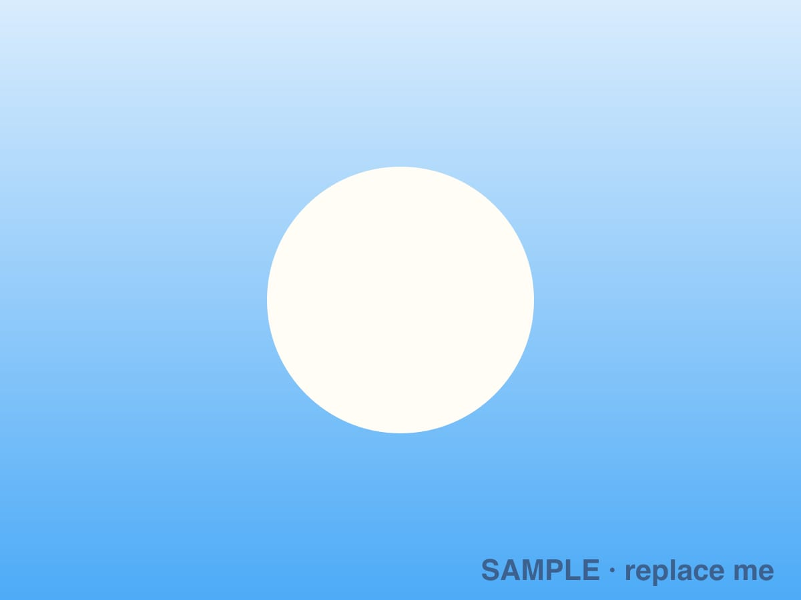
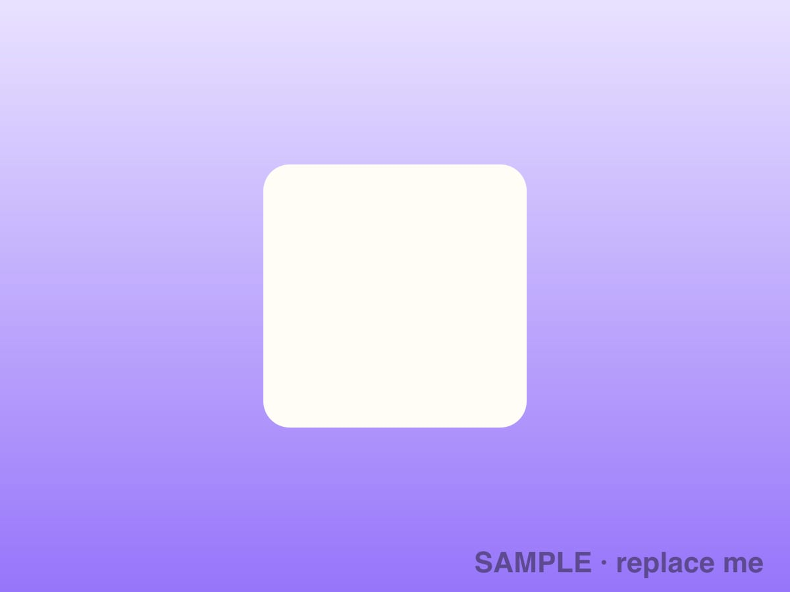
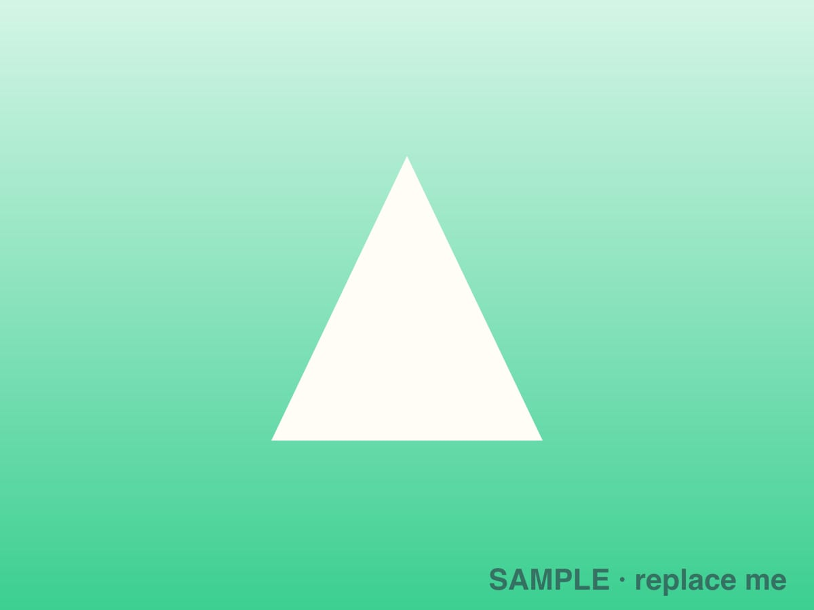

<!--
  This page shows every component so you can see how they look and check that
  they still work after changes. It is not in the menu and search engines skip it.
  Developers: keep one example of each component here (see CLAUDE.md).
-->

## Sticky note

<sticky-note>

**Reminder:** field trip forms are due Friday!

</sticky-note>

<sticky-note color="green">

Sticky notes come in red, orange, yellow, green, blue and purple.

</sticky-note>

## Show the answer

What is 7 × 8?

56! (5, 6, 7, 8: **56 = 7 × 8**.)

## Quiz question

<quiz-question>

What do plants need to make their own food?

- [ ] Only water
- [x] Sunlight, water and air
- [ ] Soil and rocks

Plants use sunlight, water and carbon dioxide from the air. That's **photosynthesis**.

</quiz-question>

## Flip cards

<flip-card front="Noun" back="A person, place or thing"></flip-card>
<flip-card front="Verb" back="An action word" color="blue"></flip-card>
<flip-card front="Adjective" back="A word that describes a noun" color="purple"></flip-card>

## Game links

<game-link href="https://phet.colorado.edu/" emoji="🔬">**PhET**: science simulations</game-link>
<game-link href="https://scratch.mit.edu/" emoji="🐱" color="orange">**Scratch**: make your own games</game-link>

## Photo grid

<photo-grid>

</photo-grid>

## A single picture

## Embedded things

Anything that gives you an "embed code" (YouTube, Google Slides, Google Forms, maps, …) can be pasted in. It shrinks to fit phones and keeps its shape.

<iframe width="800" height="400" src="https://www.openstreetmap.org/export/embed.html?bbox=-170%2C-58%2C170%2C75&amp;layer=mapnik" title="World map"></iframe>

## Plain Markdown

Text can be **bold**, *italic*, or a [link](/blog/). Links to files get an icon: [Sample worksheet](/files/sample-worksheet.pdf).

> A quote looks like this.

1. Numbered
2. Lists

- Bullet
- Lists

| Day | Homework |
| --- | --- |
| Monday | Read chapter 3 |
| Wednesday | Worksheet page 12 |

---

That squiggle above is a divider (three dashes on their own line).
